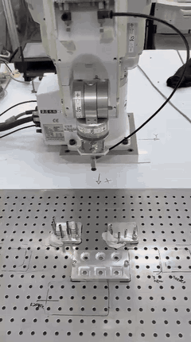
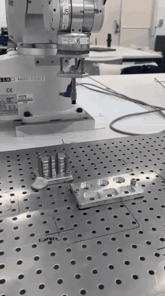

# Introduction to Robotics (Tutorial) - Epson Robot Lab

This repository is where I document the hands-on robot lab of the course
**Introduction to Robotics (Tutorial)**, fall semester 2026 (115-1).

I'm a 6th-semester Electromechanical Engineering student from Universidad
Politécnica Taiwán-Paraguay, doing my exchange year in Taiwan. The lab is done
in groups with an Epson 6-axis robot, and for the final exam we have to present
three tasks:

| Task | What the robot does | Status | Folder |
|---|---|---|---|
| 1 | **Pick and place**: moves tokens and blocks from the infeed to the tray, passing through an alignment station. The base code was given by the course. | Done | [`task1-pick-and-place`](task1-pick-and-place/) |
| 2 | **Stacking**: builds one tower in the tray, alternating token / block. | Done | [`task2-stacking`](task2-stacking/) |
| 3 | **Integration project: Robot Claw Machine**. Our classmates play an arcade claw machine where the robot is the claw (I/O box buttons, vacuum sensor, 3D-printed parts, HMI). | In design | [`task3-custom-project`](task3-custom-project/) |

## Demos

<table>
  <tr>
    <td align="center"><b>Task 1 - Pick and place</b></td>
    <td align="center"><b>Task 2 - Stacking</b></td>
  </tr>
  <tr>
    <td align="center"></td>
    <td align="center"></td>
  </tr>
</table>

<sub>Both GIFs are sped up 4x.</sub>

## The robot cell

- **Robot:** Epson C3-A600S (6-axis), programmed in **Epson RC+** with the SPEL+ language.
- **End effector:** vacuum nozzle. The vacuum is switched with **output bit 8** (`On 8` / `Off 8`).
- **Fixtures on the table:** infeed (stacks of parts), alignment station, tray ("part rack") and the TCP setup tool.
- **Parts:** round tokens and rectangular blocks (20 x 24 mm), both 6 mm thick.

Before writing any code we had to calibrate the tool (TCP) and define a local
coordinate system for each fixture. That is explained in
[`docs/workcell-setup.md`](docs/workcell-setup.md), and both tasks depend on it.

## Repository structure

```
.
├── README.md                     <- you are here
├── docs/
│   └── workcell-setup.md         <- cell layout, TCP calibration, local coordinates
├── task1-pick-and-place/
│   ├── README.md                 <- how the Task 1 program works
│   ├── Main.prg                  <- SPEL+ program (Epson RC+)
│   └── Points.pts                <- the 7 points we taught
├── task2-stacking/
│   ├── README.md                 <- how the stacking program works and how we tested it
│   └── Main.prg                  <- SPEL+ program (uses the same points as Task 1)
├── task3-custom-project/
│   └── README.md                 <- Task 3 concept and plan (claw machine)
└── media/                        <- GIFs and photos of the runs
```

## How to run the programs

1. In Epson RC+, open (or copy) the project and replace the content of `Main.prg`
   with the file from the task folder.
2. Check that the points in `Points.pts` exist in the project (Task 2 uses the
   same points as Task 1, it does not need new ones).
3. Check that **Tool 1** and the **locals** are still the ones of our group
   (they are stored in the controller, and other groups use the same robot).
4. **Project > Build**, then **Run > Run Window > Start**, always at low speed
   first with a hand near the emergency stop.

## Progress log

| Date | What we did |
|---|---|
| Oct 2026 | Measured the cell, calibrated the TCP (Tool 1) and created the local coordinates. Started the Task 1 project in RC+. |
| Nov 17, 2026 | Task 1 (pick and place) working on the real robot, saved the final points and program. |
| Nov 21, 2026 | Task 2 (stacking): wrote the program, did the dry run without I/O and then the full run with the vacuum. The tower was built correctly. |
| Nov 22, 2026 | Added the videos (as GIFs) and photos of Task 1 and Task 2. |
| Nov 23, 2026 | Chose the Task 3 project: a robot claw machine. |
| Next | Map the I/O box signals and build the first version of the claw machine. |
