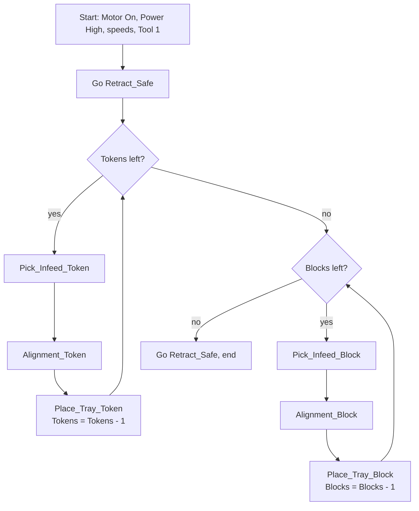

# Task 1 - Pick and place

## Goal

Move **3 tokens** and **3 blocks** from the stacks in the infeed to their own
pockets in the tray. Every part goes through the alignment station first, so it
is centered on the nozzle before it is placed.

The base program was given by the course. We imported it into Epson RC+ and
adapted it to our own cell, mainly by teaching the 7 points on our fixtures
(after doing the setup in [`docs/workcell-setup.md`](../docs/workcell-setup.md)).

Files:
- [`Main.prg`](Main.prg): the SPEL+ program we ran on the robot.
- [`Points.pts`](Points.pts): the points we taught (RC+ point file).

## Taught points

All the points were taught with **Tool 1** (the vacuum nozzle). Coordinates are
in mm and each point is stored in the local of its fixture.

| # | Point | Local | X | Y | Z | U | What it is |
|---|---|---|---|---|---|---|---|
| 1 | `Infeed_Token` | 1 (infeed) | 25.414 | 10.233 | -0.789 | 0 | Center of the **bottom** token of the infeed stack |
| 2 | `Infeed_Block` | 1 (infeed) | 30.108 | 34.233 | -0.789 | 0 | Center of the **bottom** block of the infeed stack |
| 3 | `Align_Token` | 2 (alignment) | 24.836 | 9.062 | -3.764 | 0 | Token position on the alignment station |
| 4 | `Align_Block` | 2 (alignment) | 30.563 | 32.307 | -3.264 | 0 | Block position on the alignment station |
| 5 | `Tray_Token` | 3 (tray) | 19.381 | 78.513 | -0.5 | 0 | First round pocket of the tray |
| 6 | `Tray_Block` | 3 (tray) | 50.381 | 79.013 | -0.5 | 0 | First rectangular pocket of the tray |
| 7 | `Retract_Safe` | 1 | -58.59 | -32.654 | -102.245 | -90 | Safe position above the cell (start and end) |

Remember that in our locals **-Z is up** (see the setup doc), so for example
`Retract_Safe` is about 100 mm above the infeed.

## How the program works



### Main settings

```
Speed 30          ' PTP speed, % of max
Accel 30, 30
SpeedS 500        ' linear speed (Move) in mm/s
AccelS 5000
Tool 1            ' vacuum nozzle
Tokens = 2        ' index of the top token (2, 1, 0 -> 3 tokens)
Blocks = 2
TokenHeight = 6.0 ' part thickness in mm
```

`Tokens` and `Blocks` are not "how many parts", they are the **index of the part
on top of the stack**, starting from 0 at the bottom. With 3 parts the top one
is index 2. The `For ... Step -1` loops run 3 times (2, 1, 0).

### Picking from the infeed (`Pick_Infeed_Token`, `Pick_Infeed_Block`)

The point `Infeed_Token` is the bottom token. The part on top of the stack is
`Tokens * TokenHeight` higher, so:

```
Go   Infeed_Token -Z(50 + (Tokens * TokenHeight)) CP   ' 50 mm above the top part
Move Infeed_Token -Z(Tokens * TokenHeight)             ' straight down onto it
On 8                                                   ' vacuum on
Wait .5                                                ' give the vacuum time to grip
Move Infeed_Token +X(-1) -Z(50 + (Tokens * TokenHeight)) CP   ' back up
```

| Token index | Height of the pick (above `Infeed_Token`) |
|---|---|
| 2 (top) | 12 mm |
| 1 | 6 mm |
| 0 (bottom) | 0 mm |

`Go` is used for the big moves (point to point, faster) and `Move` for the last
part (straight line), so the nozzle goes straight down into the stack and does
not hit the guide pins. The small `+X(-1)` (and `+Y(1)` for the block) on the
way up was already in the code. As I understand it, it helps the part come out
of the guide pins without rubbing against them.

### Alignment (`Alignment_Token`, `Alignment_Block`)

The vacuum doesn't always pick the part exactly in the center, so this step
fixes the position before going to the tray:

1. Put the part down on the alignment station and turn the vacuum **off**.
2. With the nozzle still at part height, move 5 mm in +X (the block also moves
   in +Y). The way I understand it, this pushes the part against the pins of the
   station, so it ends up in a known position.
3. Go up 5 mm, come back over the point and go down again.
4. Vacuum **on** and pick the part again. Now it is centered on the nozzle.

### Placing in the tray (`Place_Tray_Token`, `Place_Tray_Block`)

Every part goes to a different pocket. The pockets are 30 mm apart along the Y
axis of the tray local, so the position depends on the index:

```
Go   Tray_Token +X(-.05 * Tokens) +Y(-30. * Tokens) -Z(20) CP   ' 20 mm above the pocket
Move Tray_Token +X(-.05 * Tokens) +Y(-30. * Tokens)             ' down into the pocket
Off 8                                                            ' release
Wait .5
Move Tray_Token +X(-.05 * Tokens) +Y(-30. * Tokens) -Z(50) CP   ' up
Tokens = Tokens - 1                                              ' next part
```

| Token index | Pocket position (relative to `Tray_Token`) |
|---|---|
| 2 | Y - 60 mm |
| 1 | Y - 30 mm |
| 0 | `Tray_Token` itself |

The `+X(-.05 * Tokens)` is a very small correction (0.05 mm per pocket). It
probably compensates a tiny angle between the row of pockets and the Y axis of
the tray local.

## What I learned / notes

- The `CP` parameter (continuous path) lets the next motion start before the
  current one finishes. The robot moves smoother and faster, but it "cuts the
  corner". It's fine when going up or traveling, but for the last mm down into
  a pocket a normal `Move` without `CP` is safer.
- The `For` loop variable (`TokenID`, `BlockID`) is not really used inside the
  functions. The functions read the global counters `Tokens` / `Blocks`, and
  `Place_...` decreases them. It works, but it's easy to make a mistake. In
  Task 2 we changed this and passed the index as a function parameter.
- `Wait .5` after `On 8` / `Off 8` is important, because the vacuum needs time
  to build up or release. Without it the part can stay on the nozzle or fall.
