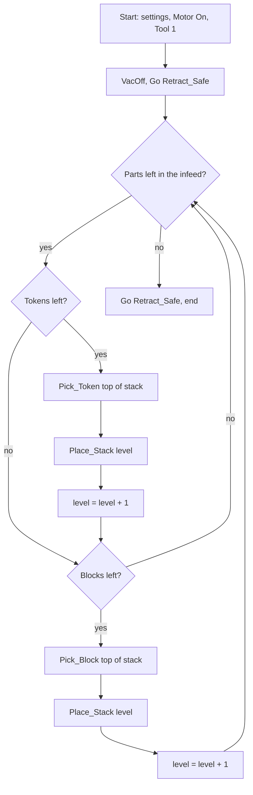

# Task 2 - Stacking

## Goal

Take all the parts from the two stacks in the infeed (tokens and blocks) and
build **one single tower** in a round pocket of the tray, alternating:

```
level 9   block
level 8   token
  ...
level 1   block
level 0   token   <- inside the round pocket of the tray
```

With 5 tokens and 5 blocks the tower has 10 levels (60 mm high).

In this task the alignment station is **not used**, so the program only needs
2 locals: **Local 1 (infeed)** and **Local 3 (tray)**.

File: [`Main.prg`](Main.prg) (SPEL+, Epson RC+).

## What changed compared to Task 1

| | Task 1 - Pick and place | Task 2 - Stacking |
|---|---|---|
| Where the parts go | Each part in its own pocket (30 mm apart in Y) | All parts in the **same pocket**, one on top of the other |
| Order | First all tokens, then all blocks | Alternating: token, block, token, block... |
| Alignment station | Yes (Local 2) | No |
| Points | 7 points | Same points, only `Infeed_Token`, `Infeed_Block`, `Tray_Token` and `Retract_Safe` are used. **No new points.** |
| Index of the part | Global counters changed inside the functions | Passed as a **parameter** to each function |
| Going down to place | `Move` after a `Go ... CP` | `Go` without `CP` + slow straight `Move` (`SpeedS SlowS`) so it doesn't hit the tower |
| Vacuum | `On 8` / `Off 8` directly | `VacOn()` / `VacOff()`, controlled by the `UseIO` switch |

The key change is in the place position. In Task 1 the robot moved **30 mm in
Y** for each new part. In Task 2 it stays in the same pocket and goes **6 mm
higher (in Z)** for each new level.

## How the program works



### Settings (top of `main`)

| Variable | Value | Meaning |
|---|---|---|
| `NTokens`, `NBlocks` | 5, 5 | How many parts are in each infeed stack |
| `PartH` | 6.0 mm | Thickness of one part |
| `PlaceGap` | 0.5 mm | The part is released 0.5 mm above the tower, so the nozzle never pushes down on it |
| `ApproachH` | 40 mm | Height above the tower before going down |
| `FastS` | 500 mm/s | Normal linear speed |
| `SlowS` | 30 mm/s | Linear speed for the last move down onto the tower |
| `UseIO` | True / False | Turns the vacuum (output 8) on or off for the whole program |

### Height calculation

Same as in Task 1, in our locals **-Z is up**.

- **Pick:** `Infeed_Token` is the bottom part of the stack, so the part with
  index `idx` is `idx * PartH` higher: `Infeed_Token -Z(idx * PartH)`.
- **Place:** `Tray_Token` is the position of the first token inside the pocket.
  Level `lvl` is `lvl * PartH` higher, plus the small gap:
  `Tray_Token -Z(lvl * PartH + PlaceGap)`.

The infeed goes **down** 6 mm each time (the stack gets smaller) and the tower
goes **up** 6 mm each time:

| # | Part | Index in the infeed | Pick offset | Tower level | Release offset |
|---|---|---|---|---|---|
| 1 | Token | 4 | `-Z(24)` | 0 | `-Z(0.5)` |
| 2 | Block | 4 | `-Z(24)` | 1 | `-Z(6.5)` |
| 3 | Token | 3 | `-Z(18)` | 2 | `-Z(12.5)` |
| 4 | Block | 3 | `-Z(18)` | 3 | `-Z(18.5)` |
| 5 | Token | 2 | `-Z(12)` | 4 | `-Z(24.5)` |
| 6 | Block | 2 | `-Z(12)` | 5 | `-Z(30.5)` |
| 7 | Token | 1 | `-Z(6)` | 6 | `-Z(36.5)` |
| 8 | Block | 1 | `-Z(6)` | 7 | `-Z(42.5)` |
| 9 | Token | 0 | `-Z(0)` | 8 | `-Z(48.5)` |
| 10 | Block | 0 | `-Z(0)` | 9 | `-Z(54.5)` |

### Functions

- **`Pick_Token(idx)` / `Pick_Block(idx)`**: go 50 mm above the top part, go
  straight down, vacuum on, go back up. The small offsets on the way up
  (`+X(-1)`, `+Y(1)`) are the same ones we used in Task 1.
- **`Place_Stack(lvl)`**:
  ```
  zUp = lvl * PartH + PlaceGap
  Go   Tray_Token -Z(zUp + ApproachH)   ' 40 mm above the tower
  SpeedS SlowS
  Move Tray_Token -Z(zUp)               ' straight down, slow
  VacOff()                              ' release
  Move Tray_Token -Z(zUp + ApproachH)   ' straight up
  SpeedS FastS
  ```
  I removed the `CP` before going down. With `CP` the robot starts going down
  before it finishes the move above the tower, so it would come in diagonally
  and could hit the tower.
- **`VacOn()` / `VacOff()`**: only switch output 8 when `UseIO = True`, and wait
  0.5 s in both cases.

## Without I/O and with I/O

The program is tested in two steps, changing only one line:

1. **`UseIO = False`, without I/O (dry run).** The robot does all the
   movements but the vacuum never turns on. The infeed and the tray have to be
   **empty**. Because the robot doesn't really take the parts, the stack would
   still be there, and on the next pick the nozzle would go into it.
   We used this run to check that:
   - in the infeed every pick is 6 mm lower than the one before,
   - in the tray every release is 6 mm higher than the one before,
   - nothing hits the pins or the tray.
2. **`UseIO = True`, with I/O.** First we tested the vacuum alone in the
   Command Window (`On 8`, `Off 8`), then loaded the stacks in the infeed and
   ran the program at low speed, watching the first token go into the pocket.

## Testing checklist

- [x] Tool 1 and Locals 1 and 3 checked (`Go Tray_Token -Z(10)` and `Go Infeed_Token -Z(10)` in the Command Window, the nozzle should be centered)
- [x] Build without errors
- [x] Dry run with `UseIO = False`, cell empty, `Speed 10`
- [ ] Vacuum test in the Command Window (`On 8` / `Off 8`)
- [ ] Full run with `UseIO = True`, low speed
- [ ] Full run at normal speed + video

## If something goes wrong

| Problem | What to change |
|---|---|
| The nozzle doesn't reach the top part in the infeed, or pushes into it | Measure the real thickness of the parts and update `PartH` |
| The nozzle pushes the tower when releasing | Increase `PlaceGap` (for example 1.0) |
| The tower is not straight / a part falls | Lower `SlowS` (for example 20). If it's always shifted to the same side, re-teach `Tray_Token` |
| The part stays stuck on the nozzle | Increase the `Wait` in `VacOff` (for example 0.8 s) |
| The part hits something on the way from the infeed to the tray | Increase `ApproachH` (for example 60) |

## Notes

- Speed limits of the C3 (from the manipulator manual): `Speed` goes up to 100
  (it's a %), `SpeedS` up to 2000 mm/s, `AccelS` up to 25000 mm/s². We don't
  need to go near those values, and for stacking it's better to keep the last
  move down slow.
- The program works with a different number of tokens and blocks too (for
  example 5 and 4). The loop just continues with the parts that are left.
